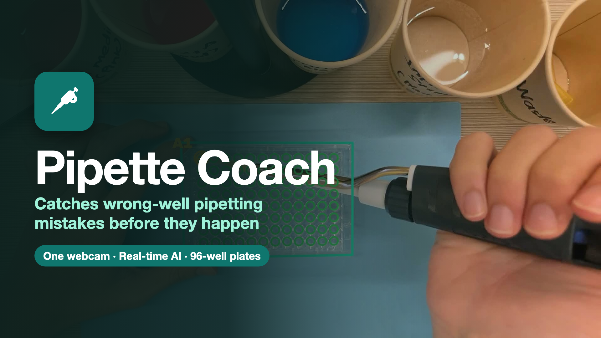

<p align="center"></p>

# Pipette Coach

**Real-time webcam AI that tracks the pipette tip and stops wrong-well errors before they ruin experiments.**
Hackachusetts 2026 · Biotech & Healthcare track

## The problem

Most 96-well plates are still filled by hand: 96 identical wells, several liquids per well in a set order, timers
in between, and only pen, paper and memory to keep your place. One wrong, skipped or doubled well can ruin the whole
experiment, and nobody finds out until days later. Today's fixes are a second person checking every well, or a
tracker that costs thousands and needs special pipettes.

## The solution

One ordinary webcam above the bench, and an app that knows your plan. Tap the substance in your tip and every well
that needs it lights up. Hover over the wrong well and it warns you **before** a drop goes in. Hover over the right
one and you get the go. Each dispense is checked off and logged automatically. Any pipette, any standard plate, no
extra hardware.

## The 5 detection layers

All five run live on a laptop at about 30 frames per second.

1. **Plate:** AI finds the plate in every frame and keeps up when it moves.
2. **Wells:** maps all 96 wells to their exact positions, A1 to H12.
3. **Tip:** a second model finds the pipette tip and the well under it.
4. **Dispense:** the tip holding on one well for 1.5 s counts as a dispense.
5. **Plan check:** each well is checked against the plan as you go. The right well gets a green ring and a chime.
   A wrong well, wrong substance, wrong order or a timer still running gets a red alert, before you dispense.

## Run it

```bash
pip install -r requirements.txt
python wellPlateUiWeb/app.py --app                                       # the app
python scripts/live_demo.py --camera 0 --show --ui http://localhost:7500  # the camera
```

Model weights (`models/`) and datasets are not in the repo. Built with Kiro (IDE + CLI); its steering files and
skills are in `.kiro/`.
